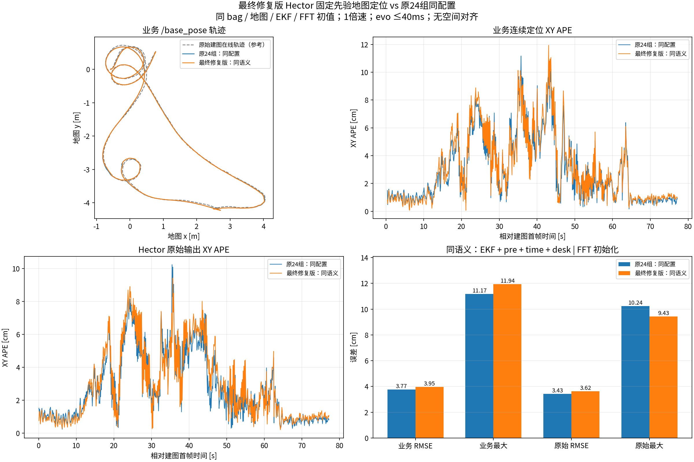

# Hector SLAM — ROS 2 Jazzy 在线版本

## 一键安装构建（无需预装 Cartographer）

本机入口：

```bash
bash /home/lc/hector_slam_ros2/install.sh
source /home/lc/hector_slam_ros2/install_online/setup.bash
bash /home/lc/hector_slam_ros2/run_online.sh output_directory:=/absolute/new_result
```

新机器克隆后，在仓库根目录执行：`bash scripts/install.sh --workspace /absolute/hector_ws`。安装器会生成该工作空间根目录的 `install.sh` 和 `run_online.sh` 入口。脚本检查并安装缺失的通用系统开发包，依赖deb缓存放入`3rd/debs`，清除外部overlay后编译全部在线包。先安装ROS2 Jazzy；不需要安装或source Cartographer、cartographer_ros或ZX工作区。`--dry-run`只检查，`--skip-system-deps`在系统依赖已具备时跳过apt。

- 工作空间`3rd`入口指向仓库`3rd`，第三方源码随仓库保存，不依赖另一工作空间。
- `hector_backend_core`：编译`3rd/cartographer`内的工具/位姿图源码。
- `hector_backend_msgs`：本地子图消息/服务。
- `hector_backend_rviz`：本地RViz子图插件。
- `hector_backend`：在线后端、离线对照、launch及RViz配置。
- `hector_cloud_frontend`：修复版Hector前端及去畸变。
- `hector_mapping`、`hector_slam`：原有核心与元包。

默认在线入口面向此前的b0水平MultiEcho+IMU背包。Hector位姿保留在`hector_local_map`，后端发布`map→hector_local_map`，前端不接受后端优化位姿回灌。RViz通过`/submap_list`、`/submap_query`显示子图，`/backend_path`显示优化轨迹；`/map`为合成地图。

另一个终端（同一ROS_DOMAIN_ID，默认228）以1倍速播放原bag：

```bash
source /opt/ros/jazzy/setup.bash
export ROS_DOMAIN_ID=228
export RMW_IMPLEMENTATION=rmw_cyclonedds_cpp
ros2 bag play /absolute/bag --clock 200 --rate 1
```

结束后调用最终优化和保存：

```bash
source /home/lc/hector_slam_ros2/install_online/setup.bash
export ROS_DOMAIN_ID=228
export RMW_IMPLEMENTATION=rmw_cyclonedds_cpp
ros2 service call /finish_hector_backend std_srvs/srv/Trigger '{}'
```

Ceres、Eigen、Protobuf、Lua、Boost等属于通用系统依赖，由一键脚本安装；第三方SLAM源码属于工作空间内依赖。详见`docs/ONLINE_BACKEND.md`与`3rd/README.md`。

---

# 早期移植与离线验证记录

本分支基于 `noetic-devel` 的 `a5e77fd3297055f5f0776ed56fafa60790494e98`，保留 Hector 多分辨率 Gauss–Newton 匹配，迁移到 ROS 2 Jazzy，并加入固定 PGM/YAML 地图定位、EKF 预测及扫描时间补偿、最终 XYZ/重力/体素输入前处理。

**完整改动、目的、Noetic 差异、实测效果与限制见 [docs/JAZZY_CHANGES.md](docs/JAZZY_CHANGES.md)。** 该文也记录没有获得整体精度提升的对照结果。

| 目录 | 内容 |
|---|---|
| `hector_mapping` | 可独立构建的 ROS 2 建图/固定地图定位、EKF 预测、双雷达逐束与跨帧时间补偿 |
| `hector_slam` | ROS 2 元包，仅依赖已移植的核心包 |
| `hector_cloud_frontend` | 最终 XYZ 匹配输入、精确姿态配对、0.025 m 体素；复用 Cartographer 工具库，不运行其建图后端 |
| `experiments` | 原24组矩阵、背包消融及最终定位对照的本机源码快照；依赖业务工作区，明确不作为通用安装包 |
| `docs/validation` | 小型 CSV/JSON 验证与性能汇总 |
| `docs/figures` | 三模块图、前后对照图、背包漂移地图标注 |

Noetic 的其他辅助包保留源文件并添加 `COLCON_IGNORE`；它们尚未移植，不参与 Jazzy 构建。`README.txt` 为上游历史说明。

## 构建核心

环境：Ubuntu 24.04、ROS 2 Jazzy、C++17。需要 Eigen、yaml-cpp、ament/rosidl、tf2 及常见 ROS 消息包；测试需要 `ament_cmake_gtest`。EKF 运行需要 `robot_localization`。

```bash
mkdir -p ~/hector_ws/src
cd ~/hector_ws/src
git clone -b jazzy https://github.com/Scar-c/hector_slam.git
cd ~/hector_ws
source /opt/ros/jazzy/setup.bash
colcon build --packages-select hector_mapping hector_slam \
  --cmake-args -DCMAKE_BUILD_TYPE=Release -DBUILD_TESTING=ON
colcon test --packages-select hector_mapping
colcon test-result --verbose
source install/setup.bash
```

基础建图：

```bash
ros2 launch hector_mapping mapping.launch.py scan_topic:=/scan
```

固定先验定位，外部提供 `/scan_amcl`、`/imu`、静态外参和 `/initialpose`：

```bash
ros2 launch hector_mapping localization.launch.py map:=/absolute/map.yaml use_sim_time:=true
# 或 global_relocalization:=true 使用自写栅格候选搜索；这不是 FFT/FCSM。
```

## 最终 XYZ 前处理

当前版本已改用仓库 `3rd` 内源码编译的 `hector_backend_core`，不再需要外部 Cartographer 前缀或 `HECTOR_CARTOGRAPHER_PACKAGE` 参数。先执行上方一键安装，然后使用 `install_online` 环境。

```bash
bash scripts/install.sh --workspace ~/hector_ws
source ~/hector_ws/install_online/setup.bash
ros2 launch hector_cloud_frontend localization_ekf_xyz.launch.py \
  map:=/absolute/map.yaml use_sim_time:=true \
  robot_description_file:=/absolute/robot.urdf \
  initial_pose_file:=/absolute/business_fft.json rviz:=true
```

该入口固定 `ekf=true pre=true desk=true time=true`，使用包内示例 EKF/双雷达配置，可通过 `ekf_config`、`merger_config` 替换。默认输入 `/scan`、`/scan_back`、`/wheel_odom`、`/imu`；TF 外参必须与实际设备一致。`initial_pose_file` 接受已算好的共享 FFT 结果 `{initial_pose_x, initial_pose_y, initial_pose_yaw}` 或 `{pose:[x,y,yaw]}`；它只发布一次初值，不重新计算 FFT。

先启动并确认 RViz 后再从头播放，**仅用1倍速**：

```bash
ros2 bag play /absolute/bag_directory --clock 200 --rate 1
```

背包 b0（水平 MultiEcho + IMU，无轮速）的最终建图输入链：

```bash
ros2 launch hector_cloud_frontend backpack_xyz.launch.py use_sim_time:=true
ros2 bag play /absolute/b0-2014-07-11-11-00-49_ros2 --clock 200 --rate 1
```

该建图入口与 EKF 固定地图定位是两种独立语义；背包使用严格历史 Hector 平移速度，不把不存在的轮速/EKF补出来。8192格默认配置用于完整背包范围，内存占用较大，可按场景传 `map_size`。

## 实测结果概览

- 背包前30 s，官方 launch 行为只增加0.025 m体素：对无回环 Cartographer 在线参考的 APE RMSE **0.6133→0.0447 m**；不是 ROS 1 二进制，也不代表所有场景都改善。
- 最终背包完整513.6 s仍有累计漂移：对回环优化后的 Cartographer 最终轨迹，初始 SE(2) 对齐后的 RMSE **2.263 m**、最大 **7.877 m**，明显持续分叉约280–285 s。
- 原业务 bag，相同 `EKF + pre + time + desk` 和缓存 FFT：业务轨迹 RMSE **3.77→3.95 cm**，原始 Hector 最大误差 **10.24→9.43 cm**，**未显示整体 ATE 提升**。
- 所有这些轨迹参考都是建图算法输出，不是独立真值；没有额外地图校正量低通、全程轨迹拟合或尺度修正。



许可证与来源见 [hector_mapping/LICENSE](hector_mapping/LICENSE)、[hector_mapping/UPSTREAM.md](hector_mapping/UPSTREAM.md)、[docs/THIRD_PARTY.md](docs/THIRD_PARTY.md)。

本机规范工作空间为 `/home/lc/hector_slam_ros2`；迁移前后772帧输出逐项完全相同，见 [迁移验证](docs/validation/migration_output_equivalence.json)。旧ZX路径仅保留兼容链接，后续开发使用本工作空间。
