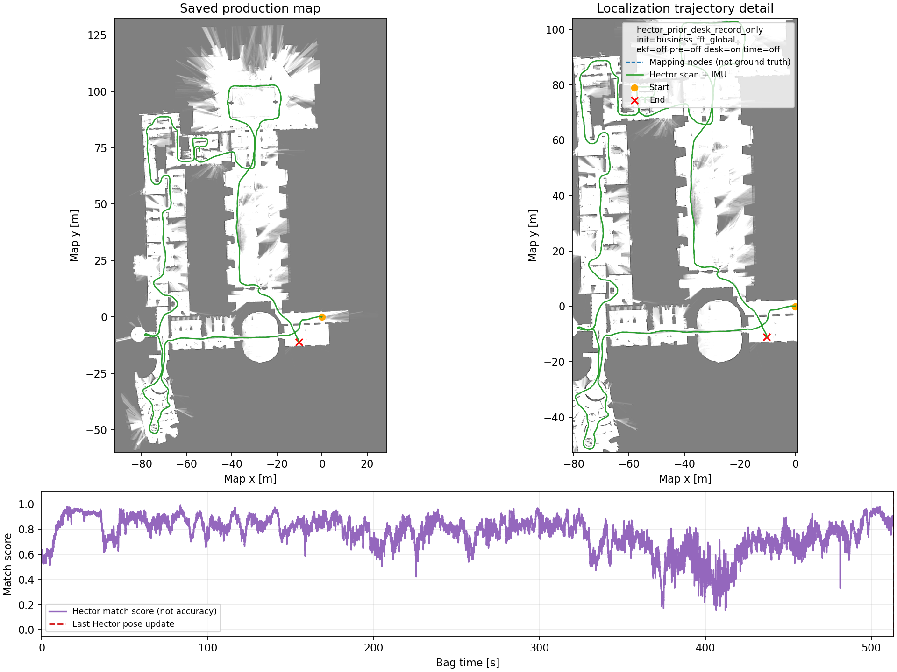

# 完整先验上的全局初始化与 Hector 连续定位

2026-11-17。完整先验来自此前修复版 Hector 前端与位姿图后端生成的 69 子图完整地图。定位阶段不启动后端，不更新地图，不输入建图轨迹。

## 公平初始化条件

- 同一张 PGM/YAML、同一份修复版首帧点云（839点），地图完整XY范围与360°航向搜索。
- 首帧快照只提取点坐标，记录中五个运动/位姿字段直接跳过；没有 `[0,0,0]` 初值、起点邻域或参考轨迹输入。
- FCSM使用本工作空间源码中的 `MatchFullSubmap`；FFT复用原业务 `AdaptiveFftMatcher` 核心，源文件逐字复制到 `3rd/business_fft`；自写搜索采用原全局自由格栅格候选+Hector细化，删除提示候选与提示最优值。
- 地图PGM像素、分辨率、原点不变。所有方法使用同一导入占据阈值0.52：该后端输出包含灰度概率墙体，旧0.65会把大量墙体证据归入未知。自由阈值0.196、Hector验收阈值0.45保持不变。阈值与哈希记录在实验文件中。
- 依次串行运行，计时从读图/点云起，到候选细化验证结束；不包含编译、bag采集时间。下表为本机单次测量，FFT使用原业务10工作线程，FCSM和自写搜索为单线程。

| 方法 | 搜索时间 | 总耗时（含预处理） | 全局输出 x,y,yaw | 搜索后核验 |
|---|---:|---:|---|---|
| FCSM | 74.350s | 75.617s | -9.470,-0.326,0° | 错配到相似区域，位置差9.482m |
| 原业务 FFT 核心 | 2.707s | 3.032s | -0.081,-0.033,0° | 找到起始区域，位置差0.0957m |
| 自写全局搜索 | 3.038s | 3.362s | -9.451,-0.340,-0.346° | 错配到相似区域，位置差9.464m |

核验只在三次搜索完成后读取该地图生成时的首节点；它是算法输出，不是独立真值，也没有作为搜索器输入。FCSM与自写搜索的几何评分虽通过，仍不能当作正确初始化；不要只按最大评分选结果。FFT原业务服务另有1000点门限，本帧839点不满足；本次是未改算法核心的实验，不能声称原业务服务不改配置就能直接接受。

## 固定地图定位

```bash
bash /home/lc/hector_slam_ros2/run_relocalization.sh \
  output_directory:=/absolute/new_result
```

本机默认先验为 `data/prior_hector_backend/map.yaml`；初始位姿文件为本次完整全局FFT搜索得到的 `data/global_initialization/chosen_seed.json`。入口没有手写初值，缺少结果文件会报错。自定义环境可用 `HECTOR_PRIOR`、`HECTOR_INITIALIZER_RESULT` 指定地图与全局搜索结果。

另一个终端，以1倍速从头回放：

```bash
source /opt/ros/jazzy/setup.bash
export ROS_DOMAIN_ID=230
export RMW_IMPLEMENTATION=rmw_cyclonedds_cpp
export ROS_AUTOMATIC_DISCOVERY_RANGE=LOCALHOST
ros2 bag play /absolute/bag --clock 200 --rate 1
```

点云处理完全沿用背包修复版：IMU旋转+严格历史Hector平移预测逐点去畸变，保留XYZ，精确参考姿态，一次重力投影，[-0.8,2]m高度，0.025m体素。无轮速/EKF。

RViz面板、窗口布局取自用户指定的业务amcl.rviz；固定地图、绿色Hector定位轨迹、青色实际匹配输入默认开启，另可勾选原始/去畸变XYZ。Views还保存完整地图概览视角。输出原始定位TUM、匹配状态JSONL、地图数据指纹；没有额外位姿平滑。本次背包入口显式设置 `enforce_localization_score=false`，低评分只记录为 `score_below_threshold`，不因此拒绝位姿。

## 匹配评分仅记录

曾在约373s处把低于0.45的分数直接作为拒绝条件，最后一次接受位置与该地图轨迹只差约1cm，随后因为拒绝位姿而继续使用旧位姿搜索，形成了人为失锁。不能据此认定Hector原始匹配已经失效。按用户要求，最终回放只记录评分，不通过评分拦截位姿；RViz也不因低分或缺少新位姿而自动关闭。非有限数值与现有步长有效性检查仍属于独立规则，评分开关不修改它们。

`enforce_localization_score`为可动态设置的布尔参数，其他已有入口默认保持原验收策略，背包定位入口关闭分数门控。

## 实时故障与修复

首次全程定位在约132s停止输出，最终报告参考姿态/点云队列溢出。根因是本开发新增的 `commitStaticPose` 每帧重新创建整图缓存：该图每次分配74,050,816字节，10次耗时296.843ms；输入间隔约27ms，逐渐落后，历史运动预测大量失效，随后消息配对被堵住。

改为固定先验生命周期内复用协方差查询缓存，仅重新导入地图时失效。不改变Hector优化、接受位姿或Hessian数学计算。预热后10次重复调用分配0字节、耗时0.083ms；回归验证多种位姿与重新导图后的Hessian逐项一致。18项核心测试通过。持有这块缓存会增加常驻内存，换取消除逐帧大内存分配。

同时为精确配对增加有界失配处理：只接受完全相同时间戳的姿态；当参考流已经领先缺失帧0.5s时，明确记录并丢弃该异常帧，而不使用近邻姿态或无限堵塞。完整正常回放是否出现丢弃，见本轮最终验证记录。

## 复现实验工具

一键安装器编译七个ROS包与 `build_global_initialization/global_initialize`，额外通用依赖为FFTW3和OpenCV。工具接口只有地图、点云、输出目录、算法名，没有初始位姿参数：

```bash
source /opt/ros/jazzy/setup.bash
source /absolute/hector_ws/install_online/local_setup.bash
/absolute/hector_ws/build_global_initialization/global_initialize \
  /absolute/map.yaml /absolute/scan.xy /absolute/new_results fft
# 最后一个参数可替换为 fcsm 或 hector_search
```

已保存单次耗时、各阶段配置、内存/CPU计时、首帧哈希与事后核验于 `docs/validation/global_initialization`。

## 最终完整回放（评分只记录）

结果：`/home/lc/hector_slam_ros2/results/backpack_fixed_prior_20261117_145559`。

- 1倍速、约513.58s；18934帧点云、18934个位姿，0帧拒绝，0个精确配对异常丢帧。
- 746帧低于原0.45评分线，最低0.1535，全部仍输出位姿；370–377s的265帧全部输出，最低0.1714，没有在373s停住。
- 后端节点始终未启动，固定地图数据指纹始终相同；RViz保持打开。
- evo APE：同地图坐标，无空间/尺度对齐，XY投影，最近时间差≤0.04s。RMSE0.022262m、最大0.445509m；参考为生成该先验的优化节点，不是独立真值。对全部原始位姿使用参考插值的另一口径RMSE0.024223m，不与evo最近时刻关联混用。
- 同配置短段逐点对比558对原始/去畸变XYZ：每帧均有差异，平均每帧点位移RMS0.03073m，最大单点差0.37132m；历史Hector平移补偿有效比例96.1%，IMU旋转补偿开启。显示点块默认0.045m，容易遮盖典型厘米级补偿；可分别切换显示或减小点块。

三模块结果图复用原 `scripts/plot_localization.py`，未重写绘图逻辑。图为 `overview/hector_prior_desk_record_only__business_fft_global.png`，右上角记录实际配置，评分曲线保留低分数据。


