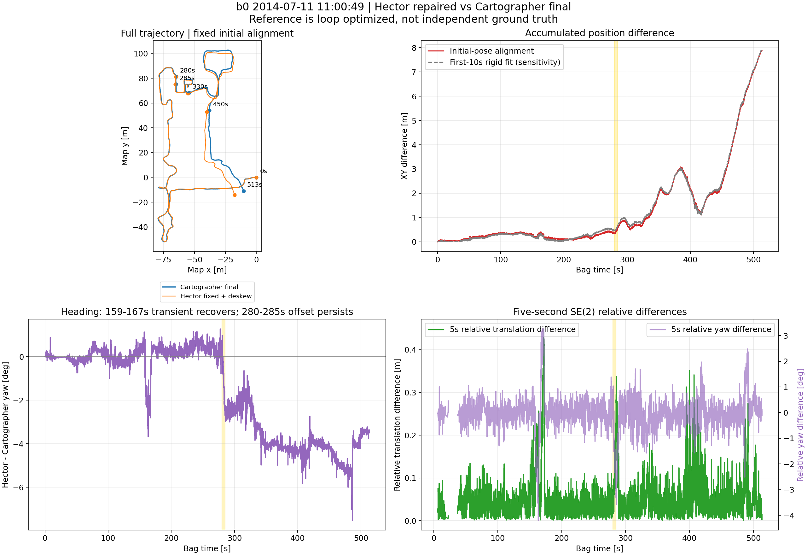
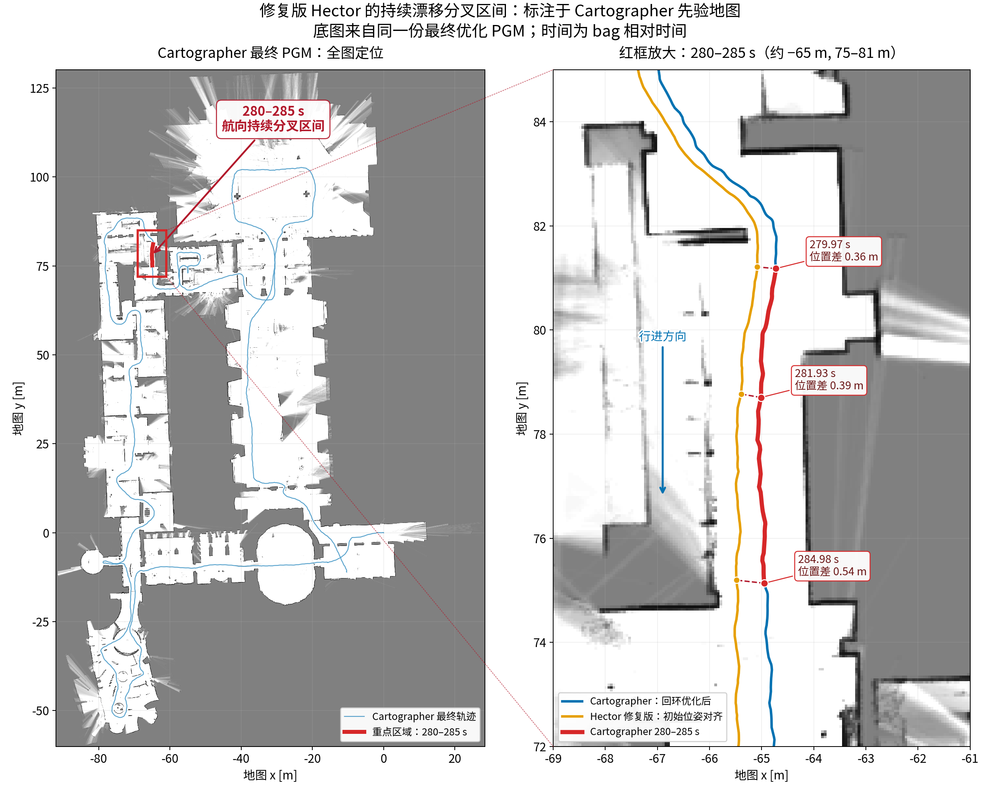
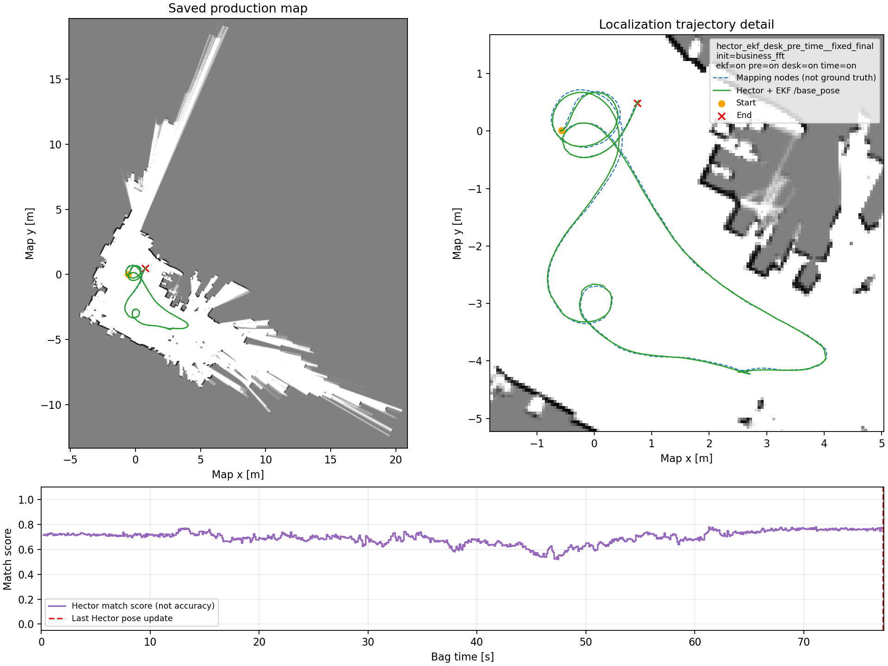

# Noetic → Jazzy：源码改动、目的与实测结果

记录日期：2026-11-16。Git 历史基线为 `noetic-devel` / `a5e77fd3297055f5f0776ed56fafa60790494e98`；当前独立分支为 `jazzy`。这是本地开发成果的 ROS 2 移植与扩展，不是上游已经发布的 Jazzy 官方版本。

## 1. 与 Noetic 的总体区别

| 项目 | Noetic 基线 | Jazzy 分支 | 目的/边界 |
|---|---|---|---|
| 平台 | ROS 1、catkin、roscpp | ROS 2 Jazzy、ament/colcon、rclcpp、C++17 | 迁移到当前运行环境 |
| 节点适配 | `HectorMappingRos.cpp` 等 ROS 1 包装层 | `hector_mapping_node.cpp`，ROS 2 消息、参数、服务、tf2 | 重写接口层；核心优化目标仍为 Hector GN |
| TF | ROS 1 tf | tf2 buffer/listener/broadcaster，按扫描时间查询 | 统一时间与坐标关系 |
| 地图发布 | ROS 1 latched/thread | ROS 2 reliable/transient-local QoS、串行执行器与定时器 | RViz晚加入仍能获得地图，避免旧线程共享状态 |
| 启动/参数 | roslaunch XML、ROS 1 参数 | Python launch、ROS 2 YAML、参数校验 | 明确可构建、可启动配置 |
| 固定先验地图定位 | 原本以建图为主 | 导入 PGM/YAML 至所有 Hector 层，禁止地图更新 | 已有地图只定位，不再建图 |
| EKF | 不是本扩展的现成完整业务链 | wheel+IMU EKF、预测初值、直接 map→odom 校正 | 同 AMCL 业务 TF 链接入 Hector |
| desk/time | 原版输入适配未加入本开发的双雷达 EKF 逐束补偿 | 两个独立开关，逐束去畸变与前后雷达统一时刻 | 消除扫描帧内和跨雷达时间差 |
| 最终点云输入 | 二维扫描投影 | 保留补偿后 XYZ、一次重力投影、高度过滤、0.025 m体素 | 改善倾斜、重复采样权重与几何输入 |
| 回环 | 无 Cartographer 式后端 | 仍无回环后端 | 不能期待自动消除全程累计漂移 |
| 其他 ROS 1 辅助包 | 原仓库全部 catkin 包 | 源码保留，未移植包标 `COLCON_IGNORE` | 不把部分移植声称为全仓所有功能均已移植 |

支持构建的包是 `hector_mapping`、ROS 2元包 `hector_slam`，以及依赖 Cartographer 工具库的 `hector_cloud_frontend`。原 ROS 1 地图服务、geotiff、trajectory server、旧 IMU 工具等辅助包未在本分支完成 ROS 2 移植。

## 2. Hector 核心的具体改动

核心路径 `hector_mapping/include/hector_slam_lib/`，直接基于上述 Noetic 提交；原 BSD 版权保留。没有改成 AMCL，也没有用 Cartographer 扫描匹配代替 Hector。

| 文件/模块 | 源码变化 | 目的及实际行为 |
|---|---|---|
| `util/UtilFunctions.h` | 移除 ROS 1 tf/geometry_msgs 工具依赖，直接包含 Eigen | 保持核心不依赖 ROS 1 |
| `map/MapDimensionProperties.h` | 索引前拒绝非有限坐标；给双线性插值邻格保留边界 | 避免 NaN/越界访问 |
| `matcher/ScanMatcher.h` | 重置时初始化 Hessian；奇异/非有限线性系统采用检查后的 FullPivLU，异常步保留当前位姿 | 避免不受检求逆导致无效数值；GN残差目标不变 |
| `slam_main/MapRepMultiMap.h` | known-pose 模式仍刷新每一层点云；导入各级固定栅格及相关访问 | 避免跳过匹配时粗层使用旧数据，支持多层静态地图 |
| `slam_main/HectorSlamProcessor.h` | `localizationOnly` 限制、静态地图导入、无写入匹配与已验收位姿提交、重置时保留固定地图 | 将跟踪状态与地图内容分离，固定地图模式阻止 `updateByScan`，包括 known-pose 路径 |

完整差异可以执行 `git diff noetic-devel..jazzy -- hector_mapping/include/hector_slam_lib` 核对。核心数值健壮性改动与输入前处理优化是不同层面的工作，不能将全部收益笼统归于一个“原版bug”。

## 3. ROS 2 适配与固定 PGM/YAML 地图

主要代码：`hector_mapping/src/hector_mapping_node.cpp`、`include/prior_map.hpp`、`include/hector_mapping_support.hpp`。

- 支持 P2/P5、8/16位 PGM、相对/绝对 image 路径、`negate`、占据/自由阈值；未知格保留未知。按图像原点进行竖直翻转，并应用 YAML 的 origin x/y/yaw。
- 输入静态地图至 Hector 多层金字塔。粗层中 occupied 优先，否则有未知子格就保留未知；边界按层级倍数补未知，发布仍使用原图尺寸/原数据。
- 内部匹配坐标使用栅格局部米制坐标，位姿初值、输出与协方差通过 YAML origin/yaw 转回地图坐标。ROS 2栅格原点使用核心首格中心左下半格的角点，替代 ROS 1包装层的历史 `/1000` 偏移。
- 固定地图每次发布检查所有先验层的占据值指纹，若发生写入则失败；reset/restart 只清除跟踪状态，不重建/清空先验。
- 低分、非有限位姿或过大帧间移动会拒绝匹配；拒绝时不把 EKF预测冒充一次新的 Hector 成功输出。
- 原激光转换使用完整激光→base外参变换端点与射线原点；无效量程、角度、元数据及参数会提前校验。Hector 的 Hessian 转为局部协方差近似并做单位换算，它不是已标定的融合噪声模型。

### 初始化究竟是什么

1. `hector_search`：自写栅格候选搜索/距离场筛选 + Hector迭代细化；**不是 FFT，也不是 FCSM**。
2. `business_fft`：业务 `AdaptiveFftMatcher` 匹配核心；两种定位器共享同一份起始扫描快照算出的缓存结果。它复用业务FFT核心，但没有启动“先建小地图再调用服务”的完整业务流程。

24组由12个定位/预处理配置×2初始化来源构成。初始化只在开始时执行，之后连续定位由所选 Hector/AMCL 完成。通用 Jazzy 包提供 `/initialpose` 接口和已算好 JSON 初值的发布器；实际业务FFT计算器与矩阵回放在 `experiments/local_business_matrix` 保存，仍需业务工作区，不将它假装成无外部依赖的官方算法。

## 4. EKF、预测、时间补偿与平滑边界

主要代码：`include/odometry_pose_prior.hpp`、`src/time_aligned_scan_merger.cpp`、`src/matrix_base_pose_from_tf.cpp`、`config/ekf.yaml`。

| 名称 | 本开发中的严格含义 |
|---|---|
| EKF | wheel + IMU 生成50Hz `odom→base_link`，示例为原业务二维配置 |
| pre | 用上一帧接受的 map 校正与当前 EKF 相对运动生成下一帧 Hector 初值；禁用额外 gyro yaw 叠加 |
| desk | 每束采集时间为 `header.stamp+i*time_increment`，用EKF TF逐束转换 |
| time | 前后雷达分别从其采集时刻转换至同一输出参考时刻 |

`map→odom = Hector(map→base at scan_stamp) × inverse(EKF(odom→base at scan_stamp))`，直接组合，**没有地图校正量低通、混合或指数平滑**。0.3s `transform_tolerance` 只延伸TF发布时间戳；原始匹配位姿保留扫描时刻。TF2自身按时间插值、EKF在两次匹配间连续传播，与人为对轨迹滤波不同。

时间点必须由真实输入及对应时刻 TF 覆盖；不以“最新TF”代替历史时间查询。扫描队列等待必要的后续IMU/EKF样本，避免回调顺序决定插值还是外推。合并与业务轨迹按ROS时间10Hz发布；记录完整输入消息，回放只允许1倍速或采用离线处理。

当前矩阵遵循 LaserScan 标准时间模型。原始驱动涉及裁剪/倒序，真实硬件逐束时间方向与首点偏移尚未完整物理标定；几何重建100%一致证明实现遵循选定模型，不能代替曝光时序验证。最终适配没有擅自改变旧矩阵的首点时间假设。

## 5. 最终修复输入链：做了什么，为什么

主要代码：`hector_cloud_frontend/src/`；重用 Cartographer `ImuTracker` 与 `sensor::VoxelFilter` 工具库，**不运行其建图、匹配或回环后端**。

背包旧链：逐点去畸变 XYZ → 0.5°二维LaserScan重采样/丢Z → 另一套0.5s姿态滤波 → 重力投影 → 高度[−1,1] → 无空间体素 → Hector。

最终链：保留去畸变XYZ → 同一参考时刻的姿态四元数 → 一次重力投影 → 高度[−0.8,2] → 0.025m三维体素 → Hector原多分辨率GN。

| 改动 | 目的 | 已验证的边界 |
|---|---|---|
| 保留XYZ | 避免二维重采样丢失倾斜/外参后的高度与点分布 | 与姿态、高度和过滤有交互，不能声称唯一必要条件 |
| 精确参考姿态配对 | 去畸变/投影不使用独立时刻的姿态；按纳秒时间戳配对 | 单独换滤波器并不足以消除旧米级偏移 |
| [−0.8,2]重力高度 | 避免倾斜时过早排除有效端点 | 对旧desk链是有效组合的一部分；原业务平面bag本轮没有点被高度筛掉 |
| 0.025m体素 | 每空间格保留原始点，减少重复空间采样对逐点累加GN的权重 | 原版行为仅加此项可显著改善本包前30s，不能普遍保证精度提升 |
| 实际射线原点 | 统一地图更新与外参几何 | 在相应消融中不是消除该段偏移的必要条件；定位合并云原点仍用base零点 |

所谓“最终修复”包含输入优化，不是给所有地图漂移加一个输出平滑补丁。官方原版没有本开发增加的0.025m体素预处理；它不是官方默认参数。没有采用实验中的软运动先验、梯度修正或步长回溯来包装结果。

两种最终节点语义：背包建图无wheel/EKF，IMU旋转补偿+严格历史Hector速度预测平移；原业务固定地图定位仍用EKF完成pre/desk/time，仅迁移XYZ/重力/体素输入优化。二者不可混为“同一个EKF方案”。

## 6. 实测效果：改善与未改善同时记录

### 6.1 背包前30秒

Bag：`b0-2014-07-11-11-00-49_ros2`。参考：Cartographer无回环在线位姿，不是独立真值。

| 对照 | 结果 | 如何理解 |
|---|---|---|
| 官方launch原版行为 | APE RMSE 0.613311m，最大0.810994m | 原样核心的ROS2适配行为对照，不是运行ROS1二进制 |
| 同原版行为仅加0.025m体素 | RMSE0.044683m，最大0.123422m | 相同0.05m、两层、0.4m/0.06rad等条件，真实1倍速；无需改地图更新阈值 |
| 旧desk输入离线复现 | 位置差RMSE1.272969m | 与下行是同一固定已记录输入的消融指标 |
| 完整XYZ/姿态/高度/体素/原点链 | 位置差RMSE0.034874m | 离线指标与在线evo最近时刻指标不可混作同一口径 |

32组输入消融说明高度和体素是旧desk链有效组合的核心，但XYZ/共享姿态存在交互；不同有效组合并不要求每一项都开启。不能把现象简单归为“原版IMU历史bug”，也不能把参数组合诱发的偏移全部归因于后续desk开发。

### 6.2 背包完整513.6秒

原版行为+0.025体素与最终修复版均完成18934个位姿；最终修复版并未消除全程漂移。以 **回环优化后的 Cartographer 最终轨迹** 为参考，一次固定初始SE(2)对齐，不做全程最优拟合或尺度修正：RMSE **2.262761m**，最大 **7.877471m**，末尾 **7.874201m**。

小幅差异约60s已出现；159–167s短暂航向差随后恢复。**280–285s出现后续持续保留的航向分叉**，约335s后位置差持续超过1m。因为Cartographer最终图调整过历史节点，这定位的是相对于最终参考的分叉区间，不能据此单凭两条轨迹认定原始前端错误恰在某一帧发生。

### 6.3 原24组业务bag：最终版同语义对照

仅运行 `hector_ekf_desk_pre_time` 这一配置。相同原bag、同Cartographer先验、同原EKF配置、同缓存业务FFT。初值与输入文件SHA均核对一致；1倍速；主参考为原建图在线轨迹。evo1.38.1，XY平移APE，最近时间≤40ms，不做空间/尺度/时间对齐。

| 输出 | 指标 | 原24组同配置 | 最终XYZ适配版 |
|---|---|---:|---:|
| 业务 `/base_pose` | RMSE | 3.7709cm | 3.9539cm |
| 业务 `/base_pose` | 最大 | 11.1687cm | 11.9414cm |
| 原始 `/slam_out_pose` | RMSE | 3.4302cm | 3.6193cm |
| 原始 `/slam_out_pose` | 最大 | 10.2405cm | 9.4293cm |

**没有观察到整体ATE提升。** 原始最大值改善约0.81cm，但不能抵消/掩盖RMSE略增。每版本只测一次，毫米级均方根差异不能当作统计显著性结论。采用保存时建图节点参考、或只比较公共关联节点，整体结论不变。三模块图继续复用原脚本，并记录配置和初始化来源。

本轮772帧全部接受，4种传感器消息完整、先验哈希唯一、原EKF逐束重建波束100%一致；XYZ与参考姿态/位姿时间戳集合完全一致，所有束重建最大3D差 **1.01e−6m**。每帧平均原始1964.7点、体素后921.5点；高度/范围过滤本轮未排除点。匹配分数均值0.6625→0.6958，**分数增大并不等价于定位精度增大**。

### 6.4 缓存FFT时的既有性能测试

旧24组工程在同机串行1倍速、关闭RViz下测试12种持续定位配置；CPU100%对应1个逻辑核，PSS实读`smaps_rollup`。例如旧 `hector_ekf_desk_pre_time` 全定位进程组平均 **20.45% CPU / 0.205逻辑核 / 42.90MiB PSS**；同语义AMCL约26.27% / 0.263 / 65.05MiB。参考机器AMD Ryzen7 H255、16逻辑CPU、powersave；播放器/记录器分开统计。

这些是**原矩阵实现**的性能，不是新增XYZ frontend的复测；没有把旧性能值套到最终适配版。见 `validation/cached_fft_performance.csv`。

## 7. 源码、验证与仓库范围

- 核心和可复用节点在ROS2包内，运行入口无本机`/home/lc`硬编码；EKF示例配置收进包内，不再硬依赖私有`odom_fusion`包。
- 最终frontend支持安装、包内launch与RViz配置；包内种子发布器读取同一FFT结果文件，不悄悄重新初始化。
- `experiments/`保留本机开发/回放/量化来源，不参与colcon发现；其中历史脚本仍含业务工作区绝对路径，需按其README在原环境复现。它们不是承诺任意机器直接运行的通用CLI。
- 不提交原始bag、MCAP、完整轨迹、模型缓存、二进制、build/install/log或虚拟环境。保留小型表格、验证JSON和说明性图像用于审阅。
- 构建及测试的实际结果记录于 `validation/BUILD_VALIDATION.md`。已有核心用例覆盖静态金字塔冻结/reset、PGM解析、重定位、外参/量程、奇异数值、IMU严格时序和EKF直接组合。

此分支保留的主要限制：无后端回环；全局候选搜索是启发式；未验证硬件逐束曝光时间；匹配分数不是准确率；Hessian协方差是局部近似；最终输入优化在背包前30s有效，不保证对已较好的平面固定地图定位继续增益。

## 8. 专用工作空间迁移与提交前一致性验证

2026-11-16，规范工作空间为`/home/lc/hector_slam_ros2`，规范Git仓库为`src/hector_slam`。原src/build/install/log完整备份到`backups/pre_jazzy_20261116`；ZX/test中的13个Hector开发目录实际迁入`legacy_development`，原位置只保留兼容符号链接。历史构建缓存与原结果保留，避免破坏既有实验索引。新开发与构建使用专用工作空间下的包。

三个包在专用工作空间重新构建成功，核心15项测试全部通过。提交前将同一份772帧XYZ、参考四元数、EKF TF与FFT初值离线逐帧输入迁移前旧节点和迁移后安装节点，每帧等待输出后再处理下一帧。两份结果数组**逐项完全相同**：772个时间戳完全一致，位置最大差0m，四元数分量最大差0。此测试也覆盖旧zx_carto与独立Cartographer库链接实现的本次输出等价性；不把这一结论扩大为所有未测试模式均已逐帧验证。完整业务1倍速实验及前10秒安装入口检查见前文；本次对比是离线处理，不是倍速bag回放。

复现工具为`tools/validation/replay_frozen_inputs.py`，机器可读结论为`docs/validation/migration_output_equivalence.json`。原始轨迹和MCAP保留在本机迁移验证/实验目录，不提交大数据。
